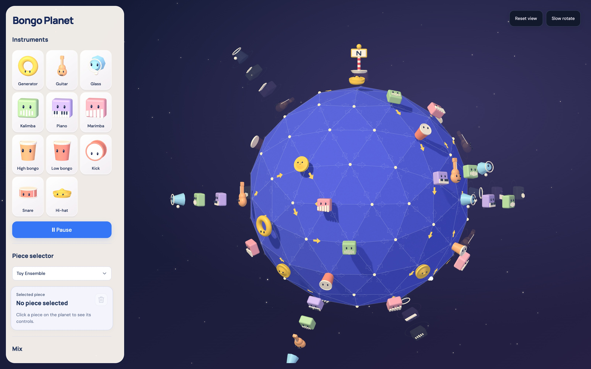
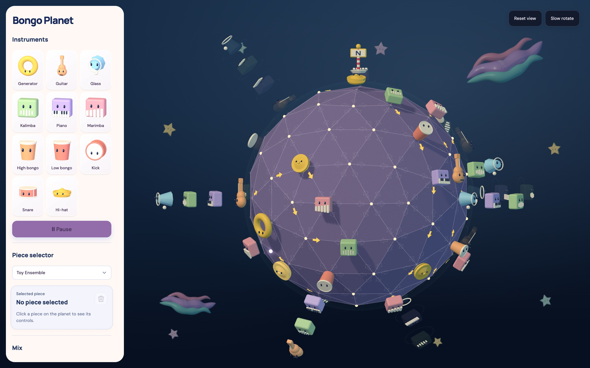
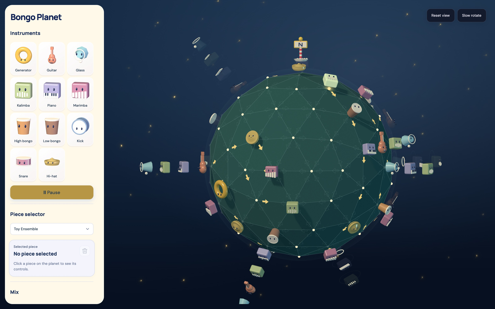

# Bongo Planet

A musical toy on a full 3V sphere. Place silent generators and five cute sampled instruments. Route sparks play each instrument they pass. The browser uses a TypeScript engine, editable Three.js characters, and stereo Harmony Bloom sample playback in an AudioWorklet.

[](https://bongo-planet.jebagu.chatgpt.site)

*Blue Marble: Toy Ensemble playing across a planet of little instruments.*

Play the public site: **[Bongo Planet](https://bongo-planet.jebagu.chatgpt.site)**.

Source: **[jebagu/Bongo-Planet](https://github.com/jebagu/Bongo-Planet)**. See [GitHub publishing](docs/GitHub.md) for the public source snapshot and the local diagnostic archives.

| Nebula | Fireflies |
| :---: | :---: |
| [](docs/screenshots/nebula.jpg) | [](docs/screenshots/fireflies.jpg) |

*Three themes, the same musical playground. Click either image to see it at full resolution.*

Start with the **[creation guide](Creation-Guide.md)** for chords, the shared musical grid and rhythmic alignment. Current gated compositions use one sixteenth note per strut crossing, independent of geometric length: 125 ms per hop at 120 BPM. Generator emissions share that grid, and all active circuits follow tempo changes at the next whole beat. These local changes reach the public site on its next publication.

## Run locally

Presets starts with **Pachelbel’s Canon** and **Toy Ensemble** in Favorites, alongside **Final Fantasy — Prelude · Reworked**. The **[Reworked](docs/Reworked.md)** collection has 42 separate cover arrangements with shaped dynamics, warmer leads, chord answers, and individually chosen tempi, using 67–92 nodes; the other 41 appear in the Reworked group after Favorites. The original versions remain in **[20 new classics](docs/Classics.md)**, **[Video game themes](docs/Video-Game-Themes.md)**, and **More presets**, including the **[first 20-song collection](docs/Songbook.md)**. Dividers separate the groups. The individual music-and-look files are in `public/songs/`; regenerate all collections with `npm run songs`, the reworks with `npm run songs:reworked`, the classics with `npm run songs:classics`, or the game themes with `npm run songs:games`.

Requires Node.js22+ and npm. From this folder:

```sh
npm ci
npm run dev
```

Open **http://127.0.0.1:5417/BongoPlanet/**. Port5417 is strict: an occupied port is an error, never an automatic new URL. First generator placement starts an empty composition; loaded scenes start paused. All controls are in one left panel: **Instruments**, Play, **Load preset**, the selected-piece editor, **Mix** with Volume and Tempo, **Composition** with Load/Save/Import/Export and Undo/Redo, then **Settings**. Content sections share one heading style, aligned padding and simple dividers. **Write music with AI** has its own section below Settings. Settings opens **Edit look** as a persistent inline tray. The globe uses a fixed orthographic camera and stays bright and interactive while the tray is open.

Choose Generator, Guitar, Glass, Kalimba, Piano, or Marimba, then click open dots repeatedly to add pieces. The tool stays active while the newest piece is highlighted. Click the active tool again or press Escape to exit placement. Select a piece to edit it; drag it to another dot to move it, or choose Move piece before clicking its destination. Drag a piece to the single trash button in the selected-piece editor to delete it; Undo restores it. Drag empty space to rotate continuously through any direction, including upside-down views. Scroll to zoom.

Fresh compositions use planet gates. All 540 directed gates remain visible on the seams independently of instrument selection, including at empty junctions. An outline means off; a solid glyph means on. Placing a generator turns all of its outgoing gates on; other junctions keep their wiring. Click a gate to toggle that direction; moving or deleting an instrument leaves the wiring on the planet. With the sphere focused, arrow keys choose a gate and Enter or Space toggles it. **Switch Chain**, **Switch Fork**, and **Infinite Circuit** demonstrate prepared wiring. **Toy Ensemble** and the four song presets retain their saved routes until a gate is edited; that click creates editable gate routing, and Undo restores the original preset. The same spark plays each instrument it passes and continues through empty vertices. See [route rules](design/Route-Journeys.md) for the older route format.

Geometric Toys is the single visual style, with painted seams aligned to the faceted planet. **Edit look** offers three spark styles: **Ember** (hot orange with soft glowing haze), **White ball** (the default), and **Lightning** (a yellow bolt with a zigzag trail). Five flat gate icons are selectable: **Arrow**, **Chevron**, **Triangle**, **Bolt**, and **Comet**. The tray also contains 12 color swatches per character/planet, four gradient backgrounds and a star field, friend size, and sunshine. Eyes and bounce stay enabled. Every section in Edit look is expanded. Changes apply live and save automatically in this browser. **Look files** contains **Export look file** and **Import look file** for transferring appearance alone; the main panel's **Save / Load** and **Export / Import** carry music and look together. **Reset to defaults** restores the original appearance. Key, scale and rhythm metadata are saved in files; their UI controls are absent.

## Compose with an AI agent

Open **Write music with AI** in its own section below Settings for the standalone introduction and AI guide at **http://127.0.0.1:5417/BongoPlanet/ai-music/**. It opens in a new tab and keeps your composition open. Describe your music and visual look, and copy the prompt into your agent. It includes the current musical rules, JSON schema, allowed instruments and visuals, a complete starter file and the planet's actual neighbor map. Save the returned raw JSON as `Bongo-Planet.json`, choose **Import** in the planet, then press **Play**. **Download guide** and **Starter JSON** provide standalone references.

[Agent-Guide.md](Agent-Guide.md) is the canonical file and FAQ reference, generated from the same sources as the app's prompt. Run `npm run docs:agents` after updating instruments, looks, settings or the behavior in [Creation-Guide.md](Creation-Guide.md) and [Rules.md](Rules.md). Build regenerates it and source tests detect a stale copy. The portable file has `format: "bongo-planet-composition"`, `version: 1`, a current gated `scene`, and a complete `appearance`.

In a second terminal:

```sh
npm run bridge
```

The bridge starts a private Node worker for native monotonic control execution. Wait for its ready launch message. Bridge integration is exercised by the [output browser tests](tests/output-browser.spec.ts); the main interface no longer exposes diagnostic connection controls. Open **http://127.0.0.1:5418/receiver** to inspect decoded ADM-OSC packets and actual control receipts. The WebSocket service binds127.0.0.1:5418; UDP test receiver uses127.0.0.1:5419. The producer endpoint accepts only the instrument's localhost origin. Clock, worker or bounded-backlog failure stops the receiver and requires a bridge restart. The optional `npm run bridge -- --render-clock` retains the earlier private Chrome AudioWorklet diagnostic. See the [protocol contract](docs/Output-Protocol.md). This demonstrates numerical control delivery; venue synthesis and spatial audio remain unqualified.

## Verify

```sh
npm run verify
npm run fixtures
npx tsx scripts/independent-engine-probe.ts
npx tsx scripts/engine-evidence.ts
npx tsx scripts/audio-evidence.ts
```

`verify` typechecks/builds and runs source/audio/protocol tests plus installed-Chrome browser tests. Dev server5417 and bridge5418 must already run for browser tests. Chrome executable: `/Applications/Google Chrome.app/Contents/MacOS/Google Chrome`. Playwright video tests require `npx playwright install ffmpeg`; no replacement browser is needed. Browser artifacts are under `evidence/`. To run the production candidate after building, stop the dev server and use `npm run preview` at the same permanent URL. Live audio timing, actual Safari, unfamiliar-player, physical-touch, venue and iOS checks are separately reported. Source/offline tests do not close those gates.

Legacy fixtures F00–F14 preserve the earlier radial/route timing. Their JSON files are in `public/fixtures/`; independent delay tables and actual vertex coordinates are in `evidence/step-02/fixture-tables.md`. F15/F16/F17 demonstrate the current equal-hop gated rules; see the [fixture guide](docs/Fixture-Guide.md). Save keeps a browser-local copy; Export preserves the scene's version (2 for gated compositions, 1 for legacy compositions). Import validates before replacing the current scene and starts paused.

## Review status

Spark Gates has an implemented browser candidate, with independent circuit traces, live virtual-loopback timing, real receiver checks and retained 30-minute build snapshots. See [the Spark Gates review](evidence/spark-gates/review.md) and [its individual checklist](evidence/spark-gates/Acceptance-Checklist.md). Listening, unfamiliar-player and Safari acceptance remain open. Dense synchronized routing has a measured 64-decision audio-quantum limit; excess work pauses visibly and can be resumed after simplifying the circuit.

Implementation is in progress. No milestone is accepted while its required checks remain open. See [Acceptance-Checklist.md](Acceptance-Checklist.md), [Rules.md](Rules.md), [Work-Package.md](Work-Package.md), and [external dependencies](docs/External-Dependencies.md). Original NodeBeat research assets are preserved as reference. The instrument uses original interface graphics and the user-requested extracted Harmony Bloom samples; their redistribution rights are not established. Its release candidate excludes unrelated research explorer assets. See [build handoff](docs/Build-Handoff.md) for the tested revision, measured results and remaining acceptance work.

The lead owns contracts, engine, scheduling/cancellation and integration; bounded workers implement rendering/input and synthesis. Independent reviews record actual failures and repairs under `evidence/step-03/` and `evidence/step-09/`.

Runtime library and font license texts: [third-party notices](docs/Third-Party-Notices.md).

The instrument palette now has Generator plus Guitar, Glass, Kalimba, Piano and Marimba. Drop each character onto a vertex and adjust pitch, octave, note length and level in its inspector. The local sound bank uses the five extracted Harmony Bloom recordings in stereo. Edit look changes planet color, backgrounds and lighting. Older note/beat compositions load as piano/marimba. See [instrument details](design/Harmony-Instruments.md) for sample provenance and migration behavior.

Selected pieces have persistent friendly names such as Guitar 1 and Generator 2; their internal IDs remain unchanged. The contained editor uses aligned controls and one trash button. Each gated generator exposes Spark interval in beats, Spark travel in hops or Infinite, and Emit new sparks. Start offsets remain in composition files and are interpreted on the shared sixteenth-note grid. Legacy route information remains visible in the generator inspector; legacy fractional travel and timing stay available for saved version-one compositions. See [Rules.md](Rules.md) for the exact compatibility and tempo contract.
