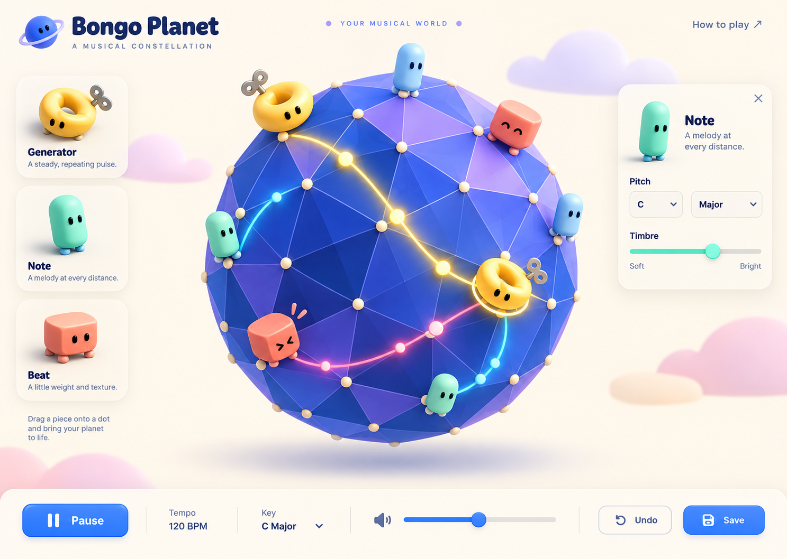

# Bongo Planet visual exploration

12 October 2026. Mockups and asset research only; application code was not changed in this exploration.

## Geometric toys with personality

Generated with the built-in Image Gen tool using the existing game screenshot as a reference. This is an illustrative screen, not an implemented interface. Direction: cobalt/lavender faceted sphere, golden sockets, yellow wind-up ring generators, mint capsule notes, coral drum beats, little eyes, tactile materials, and surface pulse paths.

## Full Mario direction

Image generation was attempted with the existing game screenshot, Mario Paint sprite contact sheet, and local Mario/Yoshi/Star sprites attached. The tool rejected the output with `moderation_blocked`, category `other`; it did not provide a specific content reason. Request ID: `8a1a2ac2-9edd-4a9b-964f-b1d6233b8977`. No Mario mockup image was returned.

The proposed scene is a grassy polygonal sphere with gold placement sockets and small orange dirt patches against a blue sky with white clouds. Preserve the spherical composition and music rules. All decoration, palette objects, controls, cursor, and visual responses use Mario-world references while the title remains Bongo Planet.

| Musical role | Proposed visual | Response |
| --- | --- | --- |
| Generator | Yellow question block | Silent upward bump, then an expanding gold wave over the sphere |
| Mario Paint mallet voice | Mario | Small hop at note onset |
| Mushroom drum | Super Mushroom | Squash and rebound |
| Yoshi voice | Yoshi | Head bob at onset |
| Music box | Power Star | Tilt and brief shine |
| Brass voice | Fire Flower | Open and spring back |
| Additional beat visuals | Goomba / Bob-omb | Quick stomp or wobble; sound mapping remains to be selected |

The instrument picker can retain the original pixel sprites while placed objects use 3D equivalents. Coin-like beads travel along surface arcs to explain timing. Trees, pipes, and scenery should stay sparse so vertices and relationships remain readable. New scenery would be visual decoration, not new gameplay.

## 3D asset shortlist

Sources checked on 12 October 2026. These are research candidates: no model archives were downloaded, converted, or tested in Bongo Planet. File lists and download controls do not establish permission to publish the underlying Nintendo artwork. Existing sprite/audio provenance is recorded in `research/mario-paint/README.md`.

| Candidate | Listing evidence | Proposed use |
| --- | --- | --- |
| [Mario](https://models.spriters-resource.com/nintendo_64/supermario64/asset/284432/) | Page opened; ZIP listing includes `mario.dae`, `mario.fbx`, and PNG textures; 156.71 KB archive | Main Mario sound node; first character to inspect for conversion |
| [Mario (Low-Poly)](https://models.spriters-resource.com/nintendo_64/supermario64/asset/468934/) | Page opened; DAE, rigged FBX, PNGs; 60.26 KB archive | Deliberately coarse visual alternative; compare silhouette before choosing |
| [Bob-omb & Bob-omb Buddy](https://models.spriters-resource.com/nintendo_64/supermario64/asset/283446/) | Page opened; DAE, custom-rig DAE, PNGs; 18.86 KB archive; billboarding feature listed | Beat piece; some original appearance uses camera-facing textures, so it needs inspection from multiple angles |
| [Warp Pipe](https://models.spriters-resource.com/nintendo_64/supermario64/asset/332294/) | Page opened; `Pipe.dae` plus PNGs; 4.60 KB archive | Sparse planet decoration or a possible generator visual |
| [Yoshi](https://models.spriters-resource.com/nintendo_64/supermario64/asset/284504/) | Present in the game index; asset detail page returned 403 | Yoshi voice node; formats/download not verified |
| [Power Star](https://models.spriters-resource.com/nintendo_64/supermario64/asset/284503/) | Present in the game index; asset detail page returned 403 | Music-box node; formats/download not verified |
| [Goomba](https://models.spriters-resource.com/nintendo_64/supermario64/asset/283660/) | Present in the game index; asset detail page returned 403 | Percussion node; formats/download not verified |
| [Blocks & Crazed Crate](https://models.spriters-resource.com/nintendo_64/supermario64/asset/461359/) | Present in the game index; asset detail page returned 403 | Possible generator source; exact block variants and formats not verified |
| [Fan-made Low Poly Mario by Aditya Voxel](https://sketchfab.com/3d-models/low-poly-mario-9d0c68839ac0434d968ecbe8080128dc) | Search listing advertises free download, FBX/textures, 8.7k triangles and CC Attribution; direct page returned 403 | Secondary lead only; download and license details require direct verification |

[Super Mario 64 game asset index](https://models.spriters-resource.com/nintendo_64/supermario64/index.html) also lists shells, switches, trees/scenery within map assets, and additional characters. Its listing was accessible.

## Proposed technical proof before implementation

Inspect one Mario character and one simple object in a separate art test. Try conversion to GLB, preserve textures and vertex colors, inspect face transparency and texture wrapping, orient feet along the sphere's radial normal, and check silhouettes from front/rear/side views. GLB conversion and compatibility are proposed, not verified. The musical engine remains independent of the art: stretch/bounce responds to existing musical events.

For original geometric toys, simple 3D meshes and small facial textures can supply the direction without external character-model dependencies.
